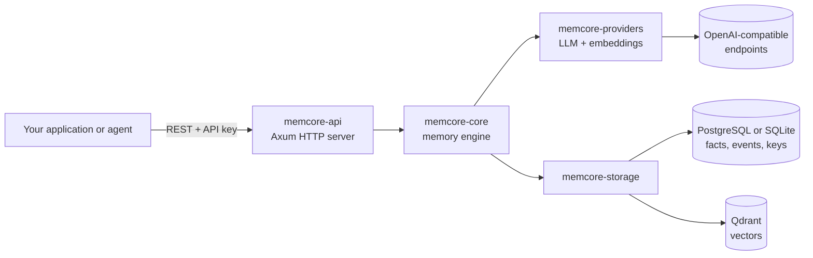

# Memquira

**A lightweight, self-hosted memory engine for AI agents, written in Rust.**

Memquira turns conversations into durable, per-user memories and returns the relevant ones when your agent
needs them, as search results or as a prompt-ready context block. Your application sends the messages it
already has; Memquira extracts facts with an LLM, stores them with their embeddings, keeps them current as new
information arrives (updates, contradictions, deletions), and retrieves them across sessions.

It runs as one Rust binary next to PostgreSQL and Qdrant (or SQLite for local development), talks to any
OpenAI-compatible LLM and embedding endpoint, and enforces tenant isolation on the server.

> **Status: 0.1.0, early release.** APIs, configuration and storage formats may change before 1.0. The project
> has not been audited by a third party. Do not store regulated or highly sensitive data in it yet.

## Why Memquira

Agents forget everything between sessions, and putting whole histories into every prompt is slow, expensive and
easy to leak across users. Memquira keeps a compact, structured memory per user instead:

- **Controlled token use.** Facts are extracted once at write time; reads return only the memories that fit a
  token budget you choose, instead of replaying the conversation.
- **Small footprint.** A single native binary with bounded concurrency, request deadlines and admission control.
- **Self-hosted.** Your data stays in your PostgreSQL and Qdrant; any OpenAI-compatible provider, including local
  models, can do the extraction and embeddings.

## Core capabilities

- Memory ingestion from chat messages (`POST /api/v1/memories`), with optional `message_id` receipts that make
  retries safe.
- LLM-based fact extraction with typed memories (profile, preference, project, task, ...), confidence and
  importance scores, and add / update / delete / no-op decisions against what is already stored.
- Hybrid retrieval: vector search combined with keyword matching by default; optional ranked full-text search
  fused with vector results by Reciprocal Rank Fusion (`rrf`).
- Prompt context assembly within a token budget (`POST /api/v1/memories/context`, `POST /api/v1/context`).
- Per-user listing, single-memory deletion, full user erasure, JSON export and import.
- Multi-tenancy: organization-scoped API keys with scopes, and per-user isolation inside an organization.
- Operations: health and readiness probes, Prometheus metrics, OpenAPI document and Swagger UI, rate limits,
  quotas, provider guardrails and a write journal that rolls back interrupted writes.

## Architecture



A write extracts candidate facts from the messages, compares each with related stored facts, applies the
decision and stores the fact with its vector. A read embeds the query, searches vectors and keywords, fuses the
results and returns them, or packs them into a context string. See [docs/architecture.md](docs/architecture.md).

## Requirements

- **Quick start:** Docker with Compose v2. No API keys or external services.
- **Production:** a Linux host with Docker (2 vCPU and 4 GB RAM is enough for a small deployment), PostgreSQL 16
  and Qdrant 1.18 (both included in the Compose stack), and an API key for an OpenAI-compatible provider.
- **Building from source:** Rust 1.89 or newer (edition 2024).

## Quick start

The local stack uses SQLite, an in-memory vector store and deterministic mock models, so it needs no keys and
makes no paid calls. It shows the API, not memory quality.

```bash
git clone https://github.com/memquira/memquira.git
cd memquira
docker compose -f docker/docker-compose.local.yml up -d --build   # first build takes several minutes
curl -s http://127.0.0.1:8080/health/ready
```

Store a memory, search it, and build a context for a later interaction:

```bash
export MEMQUIRA_URL=http://127.0.0.1:8080
export AUTH="Authorization: Bearer memcore_dev_key"   # local development key
export ORG="X-Organization-ID: demo"

curl -s -X POST "$MEMQUIRA_URL/api/v1/memories" -H "$AUTH" -H "$ORG" -H "Content-Type: application/json" \
  -d '{"user_id":"alice","session_id":"chat-1",
       "messages":[{"role":"user","content":"I am vegetarian and I live in Lisbon.","message_id":"m-1"}]}'

curl -s -X POST "$MEMQUIRA_URL/api/v1/memories/search" -H "$AUTH" -H "$ORG" -H "Content-Type: application/json" \
  -d '{"user_id":"alice","query":"vegetarian Lisbon","limit":5}'

curl -s -X POST "$MEMQUIRA_URL/api/v1/memories/context" -H "$AUTH" -H "$ORG" -H "Content-Type: application/json" \
  -d '{"user_id":"alice","query":"Suggest a restaurant for tonight","token_budget":500}'

docker compose -f docker/docker-compose.local.yml down   # add -v to delete the data volume
```

The full walkthrough, including a real model, is in [docs/getting-started.md](docs/getting-started.md).

## API integration

Every protected request carries an API key and the organization it acts for:

```http
POST /api/v1/memories/search
Authorization: Bearer <api_key>
X-Organization-ID: <org_id>
Content-Type: application/json

{"user_id": "alice", "query": "Where does the user live?", "limit": 5}
```

```json
{
  "status": "success",
  "results": [
    {"fact_id": "…", "content": "User lives in Lisbon.", "memory_type": "Profile", "score": 0.032,
     "vector_score": 0.61, "metadata": {}}
  ]
}
```

`user_id` is your application's identifier for the end user; Memquira trusts the calling application for it, so
call the API from your backend, never from a browser. Endpoints, parameters and errors:
[docs/api-reference.md](docs/api-reference.md). The server also serves `GET /openapi.json` and Swagger UI at
`GET /docs`; the committed spec is [openapi/memcore.openapi.json](openapi/memcore.openapi.json). Minimal clients
in Python, Node.js and curl are in [examples/](examples/).

## Configuration

Configuration is read from environment variables (an optional `.env` file is loaded at startup). The
`MEMCORE_` prefix is the engine's configuration namespace, and the crates and binaries keep the `memcore` name.

| Setting | Purpose |
|---|---|
| `MEMCORE_AUTH_MODE=database`, `MEMCORE_API_KEY_PEPPER` | Hashed, scoped, organization-bound API keys (`dev` mode with one shared key is for local use only) |
| `MEMCORE_POSTGRES_URL`, `MEMCORE_QDRANT_URL` | Storage (Qdrant over gRPC, port 6334) |
| `MEMCORE_LLM_*`, `MEMCORE_EMBEDDING_*` | Extraction model and embedding model, configured independently |
| `MEMCORE_SEARCH_MAX_LIMIT=100`, `MEMCORE_EPISODES_ENABLED=true` | The search limit is required by `POST /api/v1/memories/context`; episodes add source messages to it and enable message-id deduplication |
| `MEMCORE_RATE_LIMIT_*`, `MEMCORE_ADMISSION_*`, `MEMCORE_QUOTAS_ENABLED` | Abuse and capacity protection |

Starting points: [.env.example](.env.example) (local) and [.env.production.example](.env.production.example)
(production). Reference: [docs/configuration.md](docs/configuration.md). Providers:
[docs/providers.md](docs/providers.md).

## Self-hosting

```bash
cp .env.production.example .env.production   # replace every CHANGE_ME, then chmod 600
docker compose --env-file .env.production -f docker/docker-compose.prod.yml up -d --build
ADMIN_KEY=$(./scripts/ops/bootstrap_admin_key.sh my-org)   # first admin key, then mint scoped app keys
```

The production stack keeps PostgreSQL and Qdrant on an internal network and binds the API to loopback; put a
TLS-terminating reverse proxy in front of it. Deployment, backups, upgrades and maintenance:
[docs/deployment.md](docs/deployment.md) and [docs/operations.md](docs/operations.md).

## Documentation

| Document | Contents |
|---|---|
| [Getting started](docs/getting-started.md) | Local stack, first memories, switching to a real model |
| [Architecture](docs/architecture.md) | Components, write and read paths, storage, tenancy |
| [Configuration](docs/configuration.md) | Environment variables and defaults |
| [API reference](docs/api-reference.md) | Endpoints, authentication, examples, errors |
| [Providers](docs/providers.md) | OpenAI, compatible servers, local models, quality tiers |
| [Deployment](docs/deployment.md) | Production Compose stack, keys, reverse proxy, sizing |
| [Operations](docs/operations.md) | Backups, export and import, migrations, maintenance, metrics |
| [Security](docs/security.md) | Threat model, secrets, hardening checklist |
| [Development](docs/development.md) | Building, testing, project layout |
| [Troubleshooting](docs/troubleshooting.md) | Common startup and request errors |

## Security

Expose the API only through TLS and only to your own backend; keep PostgreSQL, Qdrant and `/metrics` private; use
database authentication with scoped keys; keep secrets out of git. See [docs/security.md](docs/security.md).
Report vulnerabilities privately as described in [SECURITY.md](SECURITY.md), not in public issues.

## Known limitations

- Pre-1.0: no compatibility promise between releases; back up before upgrades that add migrations.
- Rate limits, circuit breakers and some caches are per process: run one API instance per database.
- Memory quality depends on the extraction model. This project publishes no benchmark results; measure quality
  on your own data.
- Memquira authenticates applications, not end users, and has no user interface or billing.
- The clients in `examples/` are examples, not published SDK packages.

## Contributing

Issues and pull requests are welcome. Read [CONTRIBUTING.md](CONTRIBUTING.md) first; everyone taking part follows
the [Code of Conduct](CODE_OF_CONDUCT.md).

## License

Memquira is licensed under the **Apache License, Version 2.0** ([LICENSE](LICENSE)). Copyright and third-party
notices: [licenses/NOTICE](licenses/NOTICE) and
[licenses/THIRD_PARTY_LICENSES.txt](licenses/THIRD_PARTY_LICENSES.txt). The vendored Swagger UI is also Apache-2.0
([crates/memcore-api/assets/swagger-ui/LICENSE](crates/memcore-api/assets/swagger-ui/LICENSE)).
