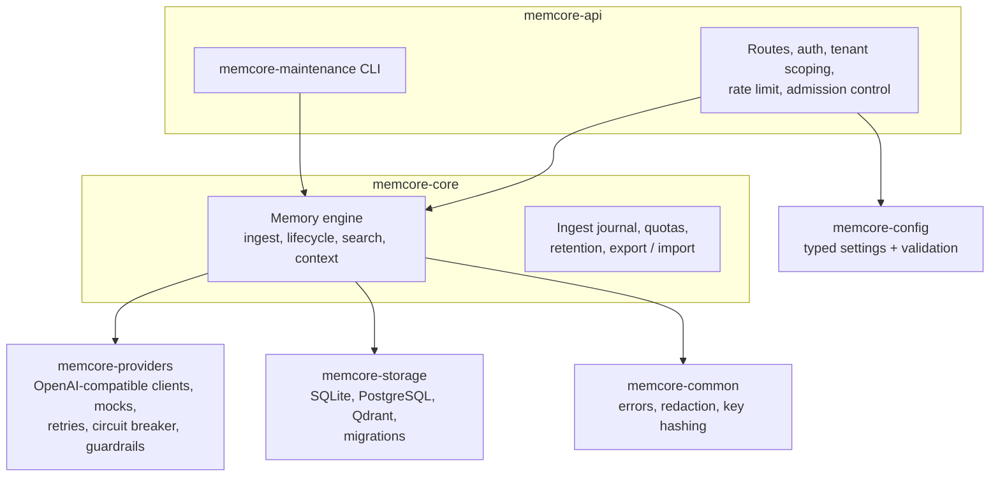

# Architecture

Memquira is a single HTTP service built from six Rust crates. The engine is storage- and provider-agnostic: it
talks to databases and models only through traits, and the API crate wires concrete backends at startup.

## Components

| Crate | Responsibility |
|---|---|
| `memcore-api` | Axum server: routing, API-key authentication, organization scoping, rate limiting, admission control, request deadlines, security headers, metrics, OpenAPI and Swagger UI. Also the `memcore-maintenance` operator CLI and the `export_openapi` tool |
| `memcore-core` | The memory engine: extraction orchestration, fact lifecycle (add / update / delete / no-op), deduplication, search, context assembly, quotas, retention, export and import, the ingest journal |
| `memcore-providers` | LLM and embedding providers behind traits: an OpenAI-compatible client, deterministic mocks, retries, timeouts, a circuit breaker, concurrency limits, provider guardrails and usage accounting |
| `memcore-storage` | Fact, event, episode and API-key stores for SQLite and PostgreSQL, the Qdrant vector store, schema migrations, startup dependency checks |
| `memcore-config` | Environment-based settings with validation at startup (`load_settings`) |
| `memcore-common` | Shared error type, log redaction, API-key hashing |

`memcore` is the engine's internal name; the crates, binaries and `MEMCORE_*` settings keep it.

## Data model

- **Fact (memory):** one statement about a user, with a type (`Profile`, `Preference`, `Project`, `Task`,
  `Knowledge`, `Event`, ...), confidence, importance, optional subject and event time, the messages it came from,
  and timestamps (`valid_at`, `invalid_at`, `recorded_at`, `updated_at`). Deletion is soft; a fact is active
  while it is not deleted, invalidated or superseded.
- **Episode (optional):** a stored source message (`MEMCORE_EPISODES_ENABLED`), searchable by meaning. Episodes
  let a context include what was actually said, and they back message-id deduplication.
- **Memory event:** an audit record of each operation (input text is never exposed through the API).
- **API key:** hashed with HMAC-SHA256 and a server-side pepper, bound to one organization, with scopes
  (`MemoryRead`, `MemoryWrite`, `MemoryDelete`, `UserDelete`, `AuditRead`, `AdminRead`, `AdminWrite`).

Every stored object carries `org_id` and `user_id`. The organization comes from the authenticated key (database
auth) and the `X-Organization-ID` header; the user from the request.

## Write path: `POST /api/v1/memories`

1. Authenticate the key, check the `MemoryWrite` scope, resolve the organization, apply rate limits, quotas and
   admission control.
2. Record the operation in the ingest journal (so an interrupted write can be rolled back) and, with episodes on,
   store each message as an episode. Messages with a known `message_id` are recognised and not stored twice.
3. Redact PII patterns from message content (`MEMCORE_ENABLE_PII_REDACTION`).
4. Extract candidate facts with the LLM, window by window (`MEMCORE_EXTRACTION_WINDOW_TURNS`). Structured
   extraction attributes each fact to a speaker, resolves dates and cites its source messages.
5. For each candidate, find related stored facts and ask the classifier for a decision: add, update an existing
   fact, delete one, or no-op. Exact duplicates are caught without a model call.
6. Embed what is stored and write the vector to Qdrant; write the fact and an audit event to the SQL store.
7. Complete the journal entry. A failure in steps 4–6 rolls the operation back instead of leaving a partial write.

## Read path

- **Search (`POST /api/v1/memories/search`):** embed the query, then run the configured retrieval strategy:
  `hybrid` (default: vector search combined with keyword matching), `semantic` (vector only), `fulltext` (ranked
  full-text only) or `rrf` (vector and full-text fused by Reciprocal Rank Fusion). Results are scoped to one user
  and exclude inactive facts unless history is requested.
- **Context (`POST /api/v1/memories/context`):** retrieve facts and episodes, order them, and keep lines in rank
  order while they fit `token_budget` (counted with the `cl100k_base` tokenizer). The response is a ready-to-use
  text block with its token count.
- **Formatted context (`POST /api/v1/context`):** search plus formatting options (sections by memory type, scores,
  timestamps, a summary section) within `max_tokens`.

## Storage modes

| Mode | Facts, events, keys | Vectors | Use |
|---|---|---|---|
| `embedded` | SQLite | `mock` (in memory) or Qdrant | Local development, tests, small single-node use |
| `production` | PostgreSQL | Qdrant | Production |

Migrations run at startup (`MEMCORE_DATABASE_MIGRATION_MODE=auto`) and are checksummed: a database whose applied
migrations differ from the binary's is refused. Qdrant collections record the embedding model's identity; the
server refuses to start against a collection built with a different embedding model or dimension.

## Reliability and resource control

- **Admission control:** bounded in-flight requests and queues per class (read, write, admin), with deadlines;
  overload answers `503 OVERLOADED` with `Retry-After`.
- **Provider limits:** process-wide concurrency for chat and embedding calls, timeouts, bounded retries, a circuit
  breaker, and guardrails on input size, output tokens and the number of calls per process.
- **Rate limits and quotas:** per-organization requests per minute; optional limits on memories per user and users
  per organization.
- **Graceful shutdown:** in-flight requests drain within `MEMCORE_GRACEFUL_SHUTDOWN_TIMEOUT_SECONDS`.

Rate limits, circuit breakers and caches are process-local: run one API instance per database.

## Quality tiers

The server reports a quality tier at `GET /ready` and can be required to start only in a given tier
(`MEMCORE_REQUIRE_QUALITY_TIER`):

- `development-mock`: mock providers (local development and tests only).
- `compatible-unvalidated`: a real provider and configuration that this project has not evaluated. This is the tier
  of most deployments, including OpenAI.
- `reference-validated`: the maintainers' reference configuration. It is a statement about that historical
  evaluation, not a live measurement of your deployment.

## Optional and experimental features

Features off by default include entities, consolidation v2, candidate-list endpoints, query analysis and
decomposition, temporal ranking, reranking and alternative context packings. They are documented in
[configuration.md](configuration.md) and are not validated for production use.
